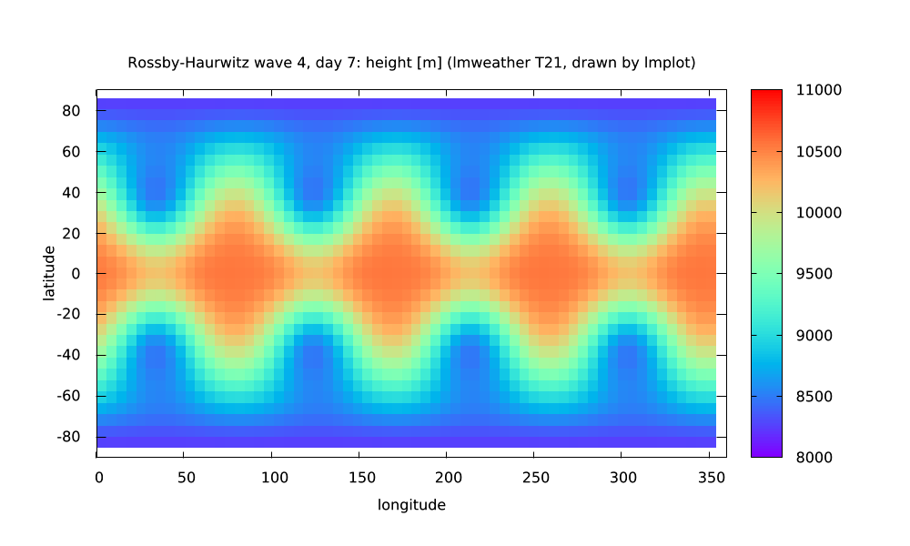
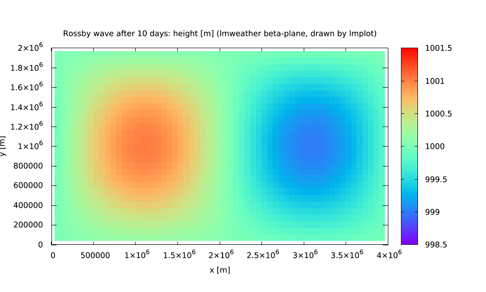

# lmweather

**Idealized weather and climate dynamics for lmscript in one static executable: rotating shallow water on the sphere
(spectral transform method, Williamson test cases) and on a beta-plane (C-grid finite differences) with seeded,
deterministic runs and CSV output.** It is a scripting host, not a command-line tool: write an
[lmscript](https://lmctl.com/tools/lmscript/skill.html) `_dsl_` block, compile it, run it with `lmweather --dsl`.
No Fortran, no NetCDF, no MPI, no data files, no shared libraries. (It is not WRF; see *Scope*.)

[](https://github.com/lmctl-ai/lmweather/actions/workflows/ci.yml)
[](LICENSE)

```
# rh.lms: the Rossby-Haurwitz wave (Williamson test case 6) drifts east; mass and energy are conserved
p = _dsl_ cli="lmweather" install="github:lmctl-ai/lmweather@latest";
let s = wx.sphere(42).williamson6();                 # T42: 128 x 64 Gaussian grid
let m0 = s.mean_height();
let e0 = s.energy();
s.run_dt(7.0 * 86400.0, 900.0);                      # seven days, 15 minute RK4 steps
wx.print("crest of wave 4 at 45N: " + str(s.wave_crest(4, 45.0)) + " deg");
wx.assert_close(s.mean_height(), m0, 0.000000001);
wx.assert_close(s.energy() / e0, 1.0, 0.0001);
s.save_csv("rh_day7.csv");                           # lon lat h u v zeta, ready for gnuplot pm3d
end _dsl_
savedsl(p, "rh.dslb");
system ${dsl_cli(p)} --dsl rh.dslb;
```

`lmscript rh.lms` finds `lmweather` on `PATH` or downloads the release binary for your platform on first use,
compiles against the schema built into it, and runs the program.

## What it does

SI units; latitudes and longitudes in degrees at the API, radians inside initial-condition expressions. Fields are set
from expression strings (`"5960 - 100 * exp(-(lon*lon + lat*lat) / 0.04)"`; variables `lon, lat` on the sphere and `x, y` on
the plane, plus a few named constants, see the schema notes) because the DSL has no closures. Runs are deterministic: same program,
same numbers, bit for bit (seeded noise through `perturb`).

| `wx.` | |
| --- | --- |
| `sphere(T)` `planet(T, radius, omega, g)` → `Sphere` | spectral model, triangular truncation T = 4..170, Gaussian grid (T42: 128 x 64), vorticity-divergence form, RK4, optional del^4 hyperdiffusion |
| `Sphere` set up | `.williamson2(alpha)` `.williamson6()` `.fields(h, u, v)` `.mode(n, m, amp, depth)` `.perturb(amp, seed, max_wave)` `.tilt(alpha)` `.diffusion(nu4)` `.mark_reference()` |
| `Sphere` run | `.run(seconds)` `.run_dt(seconds, dt)` `.stable_dt()` |
| `Sphere` diagnostics | `.time .mean_height .energy .enstrophy .max_wind .error_l2 .error_linf .height_at(lat, lon) .u_at .v_at .vorticity_at .mode_coefficient(n, m, "re"\|"im") .wave_crest(m, lat)`, `.save_csv(path)` `.save_zonal_mean(path)` |
| `plane(nx, ny, Lx, Ly)` → `Plane` | C-grid beta-plane channel: periodic in x, free-slip walls in y, RK4; linear or nonlinear |
| `Plane` set up | `.depth(H)` `.gravity(g)` `.coriolis(f0, beta)` `.linear()` `.nonlinear()` `.viscosity(nu)` `.drag(r)` `.fields(h_anomaly, u, v)` `.perturb(amp, seed)` |
| `Plane` run and diagnostics | `.run(seconds)` `.run_dt(seconds, dt)` `.stable_dt() .time .wave_speed .rossby_radius .mean_depth .energy .max_speed .pv_anomaly_rms .h_at .u_at .v_at .zonal_amplitude(m, row) .zonal_crest(m, row)`, `.save_csv(path)` `.save_row(j, path)` `.save_column(i, path)` |
| checks and output | `assert_close(a, b, tol)` `assert_true(bool)` `print(s)` `save_text(path, text)` `version()` |

Models, equations, discretization and limits: [durable-memory/03-models-and-limits.md](durable-memory/03-models-and-limits.md);
schema conventions: [durable-memory/04-schema-v0.md](durable-memory/04-schema-v0.md).




Combine it with other hosts in one script: [examples/combo/](examples/combo) integrates a model with lmweather and draws
the result with [lmplot](https://github.com/lmctl-ai/lmplot) (two `_dsl_` blocks, two hosts).

## Examples

| Program | Shows |
| --- | --- |
| [williamson2.lms](examples/williamson2.lms) | steady geostrophic flow on a tilted axis: height errors ~1e-14 over 5 days |
| [rossby_haurwitz.lms](examples/rossby_haurwitz.lms) | wave 4 over 14 days at T42: phase drift, energy and mass conservation |
| [geostrophic_adjustment.lms](examples/geostrophic_adjustment.lms) | channel adjustment to the state predicted by potential-vorticity conservation |
| [rossby_wave.lms](examples/rossby_wave.lms) | westward Rossby wave at c = -beta / (k^2 + l^2 + 1/Ld^2) |
| [gravity_pulse.lms](examples/gravity_pulse.lms) | a pulse splits into two that travel at sqrt(g H) |
| [combo/rh_wave_plot.lms](examples/combo/rh_wave_plot.lms), [combo/rossby_wave_plot.lms](examples/combo/rossby_wave_plot.lms) | lmweather integrates, lmplot draws |

`tests/` asserts known answers: gravity-wave speed sqrt(gH) (standing and travelling waves, both directions, exact to
0.05%), the spherical-harmonic gravity-wave frequencies sqrt(n(n+1) g H)/a, Williamson test case 2 at four axis tilts,
Williamson test case 6 phase speed and conservation, geostrophic adjustment against the potential-vorticity prediction,
the Rossby wave speed to 1%, exact mass conservation, energy conservation, and bitwise reproducibility.

## Build

C++17 compiler, CMake 3.24; nothing else (no third-party sources).

```sh
cmake -S . -B build && cmake --build build     # about 15 seconds
./test.sh                                      # needs lmscript on PATH
```

Linux builds are fully static; macOS links only system libraries; Windows links the MinGW runtime statically.

## Scope

lmweather is a dynamical-core playground, not a forecast system. WRF needs Fortran, NetCDF, MPI and gigabytes of geographic
and analysis data, none of which can live in one self-contained executable, so it is not wrapped. What is here is the
shallow-water layer that numerical weather prediction methods are validated on: no moisture, radiation, boundary layer,
orography or real-data initialization. See [durable-memory/09-open-items.md](durable-memory/09-open-items.md).

## License

MIT ([LICENSE](LICENSE)); no third-party code ([THIRD_PARTY_NOTICES](THIRD_PARTY_NOTICES) cites the methods).
