# lmweather

**Idealized weather and climate dynamics for lmscript in one self-contained executable: rotating shallow water on the sphere (spectral transform method, Williamson test cases) and on a beta-plane (C-grid finite differences).**

[](https://github.com/lmctl-ai/lmweather/actions/workflows/ci.yml)
[](https://github.com/lmctl-ai/lmweather/releases)
[](LICENSE)

Twenty worked problems with known answers, each made by one runnable file. Every command below runs from any empty
directory: lmweather integrates, [lmplot](https://github.com/lmctl-ai/lmplot) draws, the picture lands in `images/`.

### Test cases with published answers

| | | | |
| :---: | :---: | :---: | :---: |
| 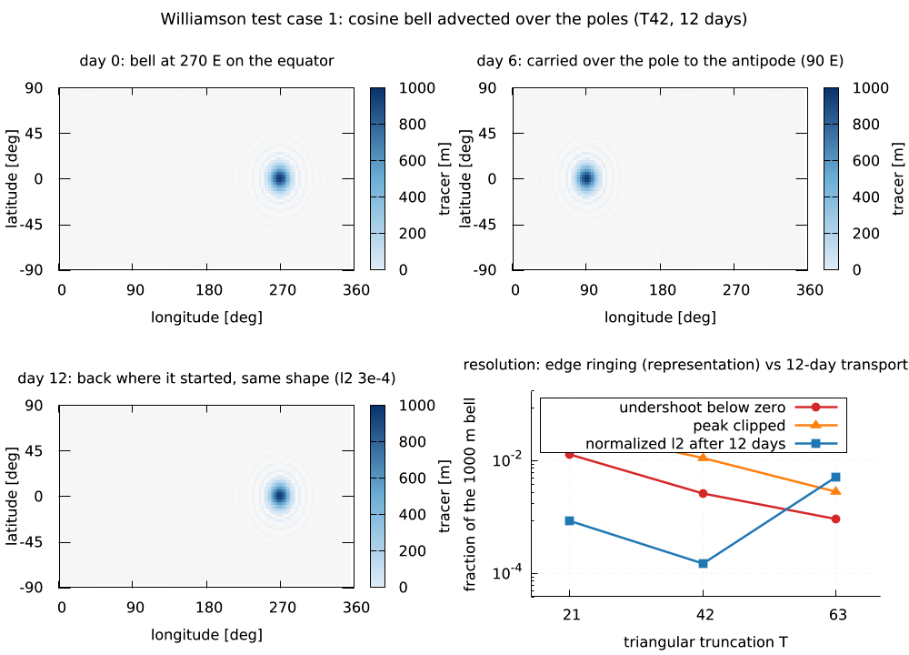<br>[Williamson TC1: a cosine bell carried over the poles and back in 12 days; the error is the edge ringing, not the transport](examples/gallery/williamson1_advection.lms)<br><sub><code>lmctl autorun https://raw.githubusercontent.com/lmctl-ai/lmweather/main/examples/gallery/williamson1_advection.lms</code></sub> | 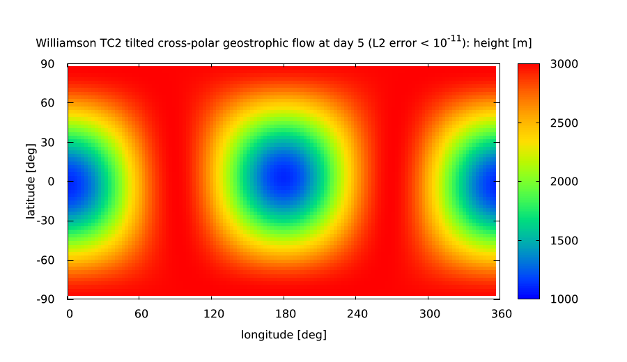<br>[Williamson TC2: tilted cross-polar geostrophic flow held steady to machine precision](examples/gallery/williamson2.lms)<br><sub><code>lmctl autorun https://raw.githubusercontent.com/lmctl-ai/lmweather/main/examples/gallery/williamson2.lms</code></sub> | 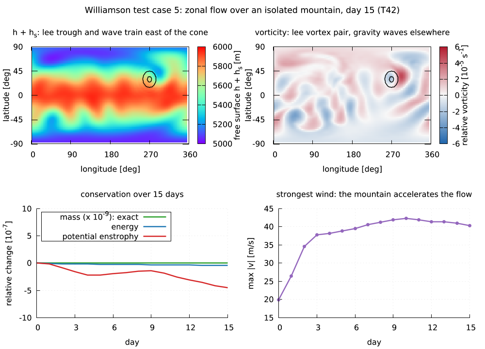<br>[Williamson TC5: flow over a 2000 m mountain, lee trough and wave train, energy and enstrophy kept to 1e-7](examples/gallery/mountain_flow.lms)<br><sub><code>lmctl autorun https://raw.githubusercontent.com/lmctl-ai/lmweather/main/examples/gallery/mountain_flow.lms</code></sub> | 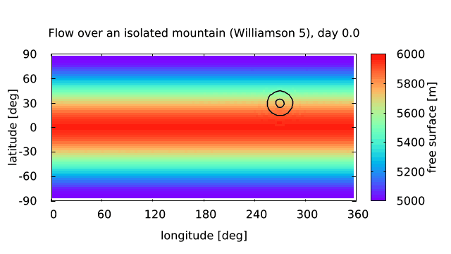<br>[TC5 in motion: 15 days of the free surface wrapping around the hemisphere, 45 frames](examples/gallery/mountain_anim.lms)<br><sub><code>lmctl autorun https://raw.githubusercontent.com/lmctl-ai/lmweather/main/examples/gallery/mountain_anim.lms</code></sub> |
| 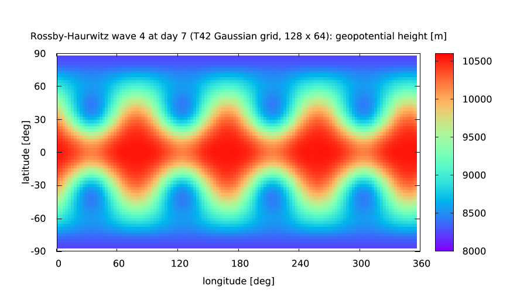<br>[Williamson TC6: Rossby-Haurwitz wave 4 at day 7 on the T42 Gaussian grid](examples/gallery/rossby_haurwitz.lms)<br><sub><code>lmctl autorun https://raw.githubusercontent.com/lmctl-ai/lmweather/main/examples/gallery/rossby_haurwitz.lms</code></sub> | 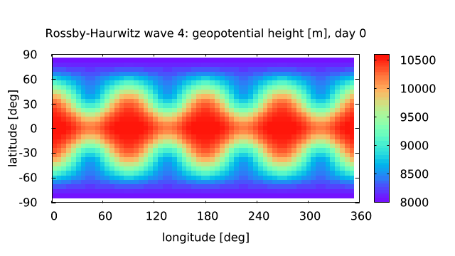<br>[TC6 wave 4 drifting east over 14 days, mass and energy conserved, 56 frames](examples/gallery/rh_anim.lms)<br><sub><code>lmctl autorun https://raw.githubusercontent.com/lmctl-ai/lmweather/main/examples/gallery/rh_anim.lms</code></sub> | 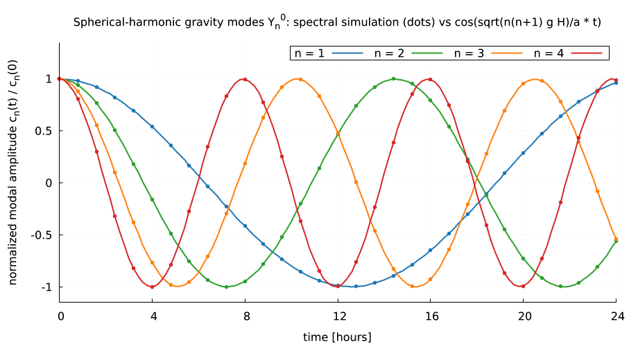<br>[Spherical-harmonic gravity modes against the exact Laplace frequencies sqrt(n(n+1) g H)/a](examples/gallery/spherical_modes.lms)<br><sub><code>lmctl autorun https://raw.githubusercontent.com/lmctl-ai/lmweather/main/examples/gallery/spherical_modes.lms</code></sub> | 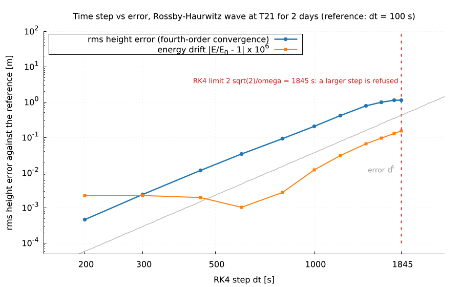<br>[Time step vs error: dt^4 convergence up to the RK4 limit 2 sqrt(2)/omega = 1845 s, above which the host refuses the step](examples/gallery/cfl_sweep.lms)<br><sub><code>lmctl autorun https://raw.githubusercontent.com/lmctl-ai/lmweather/main/examples/gallery/cfl_sweep.lms</code></sub> |

### Jets, instability and turbulence

| | | | |
| :---: | :---: | :---: | :---: |
| 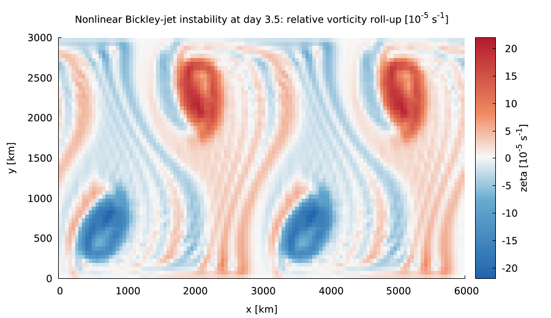<br>[Mid-latitude barotropic jet instability and vortex roll-up at T42](examples/gallery/jet_instability.lms)<br><sub><code>lmctl autorun https://raw.githubusercontent.com/lmctl-ai/lmweather/main/examples/gallery/jet_instability.lms</code></sub> | 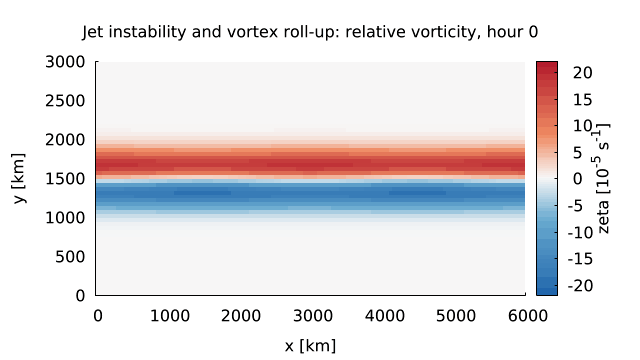<br>[The same instability on a beta-plane channel: 3.5 days of meander, break-up and roll-up, 42 frames](examples/gallery/jet_rollup_anim.lms)<br><sub><code>lmctl autorun https://raw.githubusercontent.com/lmctl-ai/lmweather/main/examples/gallery/jet_rollup_anim.lms</code></sub> | 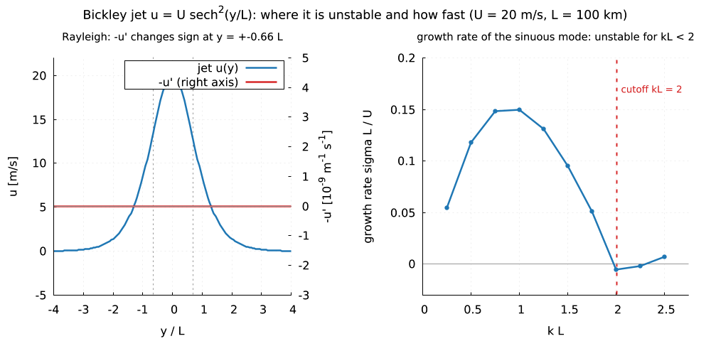<br>[Bickley jet growth rate against wavenumber: unstable for kL < 2 (Lipps 1962), fastest near kL = 0.75](examples/gallery/jet_growth_rate.lms)<br><sub><code>lmctl autorun https://raw.githubusercontent.com/lmctl-ai/lmweather/main/examples/gallery/jet_growth_rate.lms</code></sub> | 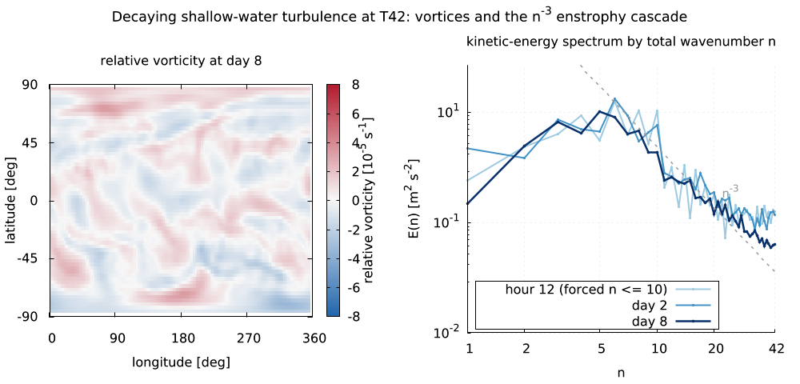<br>[Decaying turbulence on the sphere: the kinetic-energy spectrum steepens to the n^-3 enstrophy cascade](examples/gallery/energy_spectrum.lms)<br><sub><code>lmctl autorun https://raw.githubusercontent.com/lmctl-ai/lmweather/main/examples/gallery/energy_spectrum.lms</code></sub> |
| <br>[Slow against fast planetary rotation (`wx.planet`): Rhines-scale banded jets](examples/gallery/planetary_jets.lms)<br><sub><code>lmctl autorun https://raw.githubusercontent.com/lmctl-ai/lmweather/main/examples/gallery/planetary_jets.lms</code></sub> | | | |

### Beta-plane waves and adjustment

| | | | |
| :---: | :---: | :---: | :---: |
| 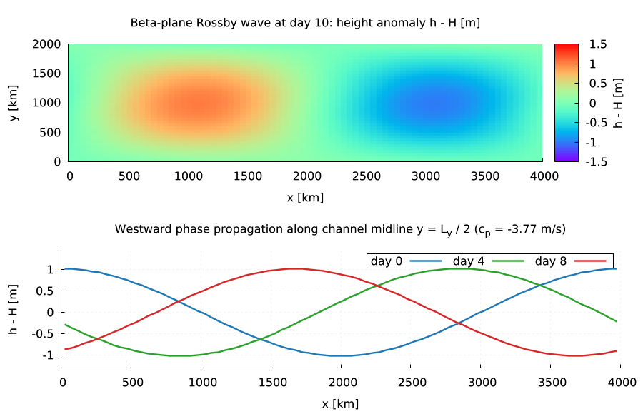<br>[Westward Rossby wave on a beta-plane: height anomaly and phase march](examples/gallery/rossby_wave.lms)<br><sub><code>lmctl autorun https://raw.githubusercontent.com/lmctl-ai/lmweather/main/examples/gallery/rossby_wave.lms</code></sub> | 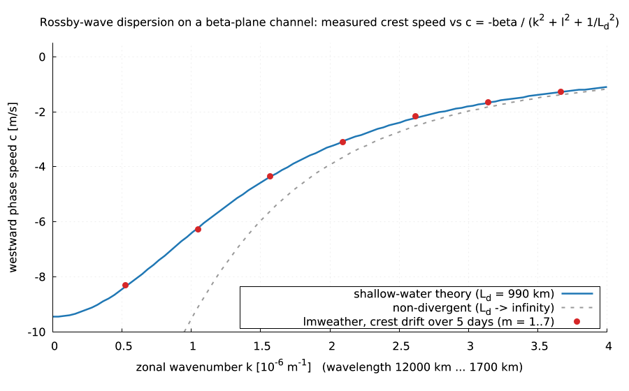<br>[The dispersion relation measured: crest speeds of waves 1-7 on c = -beta/(k^2 + l^2 + 1/Ld^2); the non-divergent formula fails for long waves](examples/gallery/rossby_dispersion.lms)<br><sub><code>lmctl autorun https://raw.githubusercontent.com/lmctl-ai/lmweather/main/examples/gallery/rossby_dispersion.lms</code></sub> | 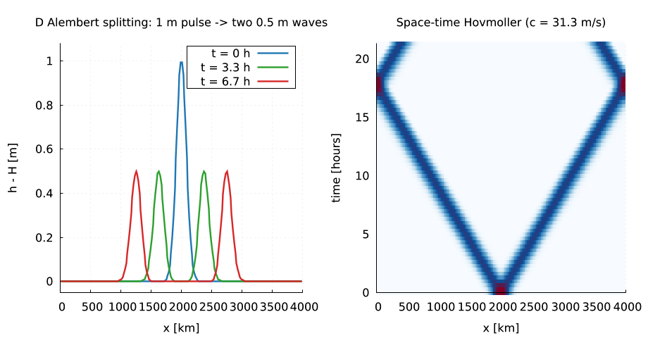<br>[A gravity pulse splits into two travelling at sqrt(g H): the Hovmoller cone](examples/gallery/gravity_pulse.lms)<br><sub><code>lmctl autorun https://raw.githubusercontent.com/lmctl-ai/lmweather/main/examples/gallery/gravity_pulse.lms</code></sub> | 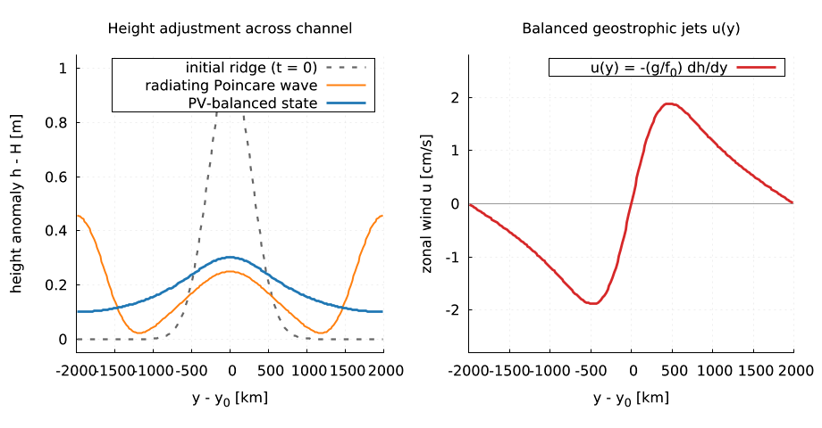<br>[Rossby adjustment: Poincare waves radiate away, a PV-balanced ridge with opposing jets remains](examples/gallery/geostrophic_adjustment.lms)<br><sub><code>lmctl autorun https://raw.githubusercontent.com/lmctl-ai/lmweather/main/examples/gallery/geostrophic_adjustment.lms</code></sub> |
| 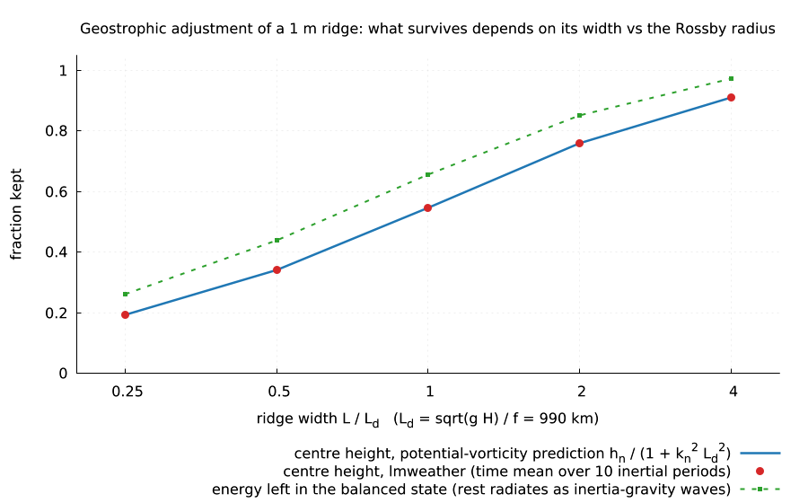<br>[Design study: a ridge narrower than the Rossby radius loses most of its height, a wide one keeps it, as PV conservation predicts](examples/gallery/adjustment_width.lms)<br><sub><code>lmctl autorun https://raw.githubusercontent.com/lmctl-ai/lmweather/main/examples/gallery/adjustment_width.lms</code></sub> | 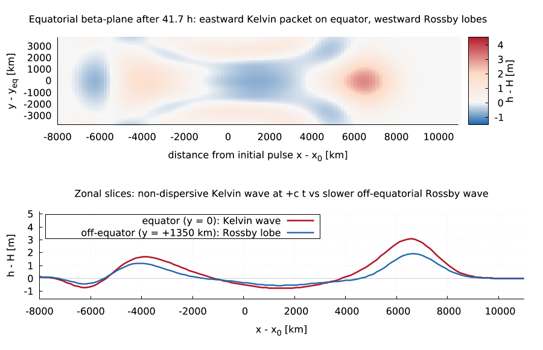<br>[Equatorial Kelvin wave east at c, Rossby lobes west at c/3 (Matsuno-Gill)](examples/gallery/equatorial_kelvin.lms)<br><sub><code>lmctl autorun https://raw.githubusercontent.com/lmctl-ai/lmweather/main/examples/gallery/equatorial_kelvin.lms</code></sub> | 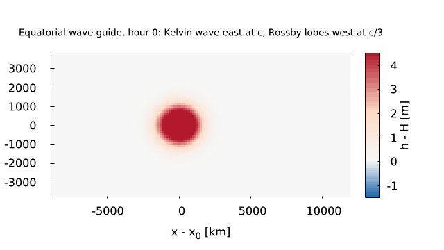<br>[The equatorial wave guide in motion: the El Nino messenger crosses 10000 km in 2.6 days, 36 frames](examples/gallery/kelvin_anim.lms)<br><sub><code>lmctl autorun https://raw.githubusercontent.com/lmctl-ai/lmweather/main/examples/gallery/kelvin_anim.lms</code></sub> | |

## One-minute start

Install [lmctl](https://lmctl.com/tools/lmscript/skill.html) (`npm install -g @lmctl-ai/lmctl`), then run any caption above
from an empty directory, for example `lmctl autorun https://raw.githubusercontent.com/lmctl-ai/lmweather/main/examples/gallery/rossby_dispersion.lms`
writes `images/rossby_dispersion.png` in about 30 s. The `install=` binding downloads the released `lmweather` and `lmplot`
on first use (Linux binaries require dynamic glibc >= 2.35, Ubuntu 22.04+); binaries already on `PATH` take priority. From a checkout, `examples/render-all.sh` regenerates `docs/images/`.

It is a scripting host, not a command-line tool: write an [lmscript](https://lmctl.com/tools/lmscript/skill.html) `_dsl_` block,
compile it, run it with `lmweather --dsl`. No Fortran, no NetCDF, no MPI, no data files, no shared libraries. (It is not WRF; see *Scope*.)

```
# rh.lms: the Rossby-Haurwitz wave (Williamson test case 6) drifts east; mass and energy are conserved
p = _dsl_ cli="lmweather" install="github:lmctl-ai/lmweather@latest";
let s = wx.sphere(42).williamson6();                 # T42: 128 x 64 Gaussian grid
let m0 = s.mean_height();
let e0 = s.energy();
s.run_dt(7.0 * 86400.0, 900.0);                      # seven days, 15 minute RK4 steps
wx.print("crest of wave 4 at 45N: " + str(s.wave_crest(4, 45.0)) + " deg");
wx.assert_close(s.mean_height(), m0, 0.000000001);
wx.assert_close(s.energy() / e0, 1.0, 0.0001);
s.save_csv("rh_day7.csv");                           # lon lat h u v zeta, ready for gnuplot pm3d
end _dsl_
savedsl(p, "rh.dslb");
system ${dsl_cli(p)} --dsl rh.dslb;
```

`lmscript rh.lms` finds `lmweather` on `PATH` or downloads the release binary for your platform on first use,
compiles against the schema built into it, and runs the program.

## What it does

SI units; latitudes and longitudes in degrees at the API, radians inside initial-condition expressions. Fields are set
from expression strings (`"5960 - 100 * exp(-(lon*lon + lat*lat) / 0.04)"`; variables `lon, lat` on the sphere and `x, y` on
the plane, plus a few named constants, see the schema notes) because the DSL has no closures. Runs are deterministic: same program,
same numbers, bit for bit (seeded noise through `perturb`).

| `wx.` | |
| --- | --- |
| `sphere(T)` `planet(T, radius, omega, g)` → `Sphere` | spectral model, triangular truncation T = 4..170, Gaussian grid (T42: 128 x 64), vorticity-divergence form, RK4, optional del^4 hyperdiffusion |
| `Sphere` set up | `.williamson1(alpha)` `.williamson2(alpha)` `.williamson5()` `.williamson6()` `.fields(h, u, v)` `.orography(hs)` `.mode(n, m, amp, depth)` `.perturb(amp, seed, max_wave)` `.tilt(alpha)` `.diffusion(nu4)` `.mark_reference()` |
| `Sphere` tracer | `.tracer(q)` passive scalar carried by the winds; `.advect_only()` freezes the dynamics (prescribed winds); `.tracer_at(lat, lon) .tracer_mean .tracer_mass .tracer_min .tracer_max .tracer_error_l2 .tracer_error_linf` |
| `Sphere` run | `.run(seconds)` `.run_dt(seconds, dt)` `.stable_dt()` |
| `Sphere` diagnostics | `.time .mean_height .energy .kinetic_energy .potential_energy .enstrophy .max_wind .error_l2 .error_linf .height_at(lat, lon) .u_at .v_at .vorticity_at .mode_coefficient(n, m, "re"\|"im") .wave_crest(m, lat)`, `.save_csv(path)` (`lon lat h u v zeta q hs`) `.save_zonal_mean(path)` `.save_spectrum(path)` (`n ke pe`) |
| `plane(nx, ny, Lx, Ly)` → `Plane` | C-grid beta-plane channel: periodic in x, free-slip walls in y, RK4; linear or nonlinear |
| `Plane` set up | `.depth(H)` `.gravity(g)` `.coriolis(f0, beta)` `.linear()` `.nonlinear()` `.viscosity(nu)` `.drag(r)` `.fields(h_anomaly, u, v)` `.perturb(amp, seed)` |
| `Plane` run and diagnostics | `.run(seconds)` `.run_dt(seconds, dt)` `.stable_dt() .time .wave_speed .rossby_radius .mean_depth .energy .max_speed .pv_anomaly_rms .h_at .u_at .v_at .zonal_amplitude(m, row) .zonal_crest(m, row)`, `.save_csv(path)` `.save_row(j, path)` `.save_column(i, path)` |
| checks and output | `assert_close(a, b, tol)` `assert_true(bool)` `print(s)` `save_text(path, text)` `version()` |

Models, equations, discretization and limits: [durable-memory/03-models-and-limits.md](durable-memory/03-models-and-limits.md);
schema conventions: [durable-memory/04-schema-v0.md](durable-memory/04-schema-v0.md).

Combine it with other hosts in one script: [examples/gallery/spherical_modes.lms](examples/gallery/spherical_modes.lms) integrates
four spherical-harmonic gravity modes with lmweather and plots them against the analytical Laplace tidal frequencies with
[lmplot](https://github.com/lmctl-ai/lmplot) (two `_dsl_` blocks, two hosts).

<p align="center">
  <br>
  <a href="examples/gallery/spherical_modes.lms">Spherical-harmonic gravity modes Y_n^0 vs exact Laplace frequencies</a><br>
  <sub><code>lmctl autorun https://raw.githubusercontent.com/lmctl-ai/lmweather/main/examples/gallery/spherical_modes.lms</code></sub>
</p>

## Examples

| Program | Shows | Run it |
| --- | --- | --- |
| [williamson2.lms](examples/williamson2.lms) | steady geostrophic flow on a tilted axis: height errors ~1e-12 over 5 days | `lmctl autorun https://raw.githubusercontent.com/lmctl-ai/lmweather/main/examples/williamson2.lms` |
| [rossby_haurwitz.lms](examples/rossby_haurwitz.lms) | wave 4 over 14 days at T42: phase drift, energy and mass conservation | `lmctl autorun https://raw.githubusercontent.com/lmctl-ai/lmweather/main/examples/rossby_haurwitz.lms` |
| [geostrophic_adjustment.lms](examples/geostrophic_adjustment.lms) | channel adjustment to the state predicted by potential-vorticity conservation | `lmctl autorun https://raw.githubusercontent.com/lmctl-ai/lmweather/main/examples/geostrophic_adjustment.lms` |
| [rossby_wave.lms](examples/rossby_wave.lms) | westward Rossby wave at c = -beta / (k^2 + l^2 + 1/Ld^2) | `lmctl autorun https://raw.githubusercontent.com/lmctl-ai/lmweather/main/examples/rossby_wave.lms` |
| [gravity_pulse.lms](examples/gravity_pulse.lms) | a pulse splits into two that travel at sqrt(g H) | `lmctl autorun https://raw.githubusercontent.com/lmctl-ai/lmweather/main/examples/gravity_pulse.lms` |
| [gallery/rh_anim.lms](examples/gallery/rh_anim.lms) | 56-frame 14-day Rossby-Haurwitz wave 4 animation encoded with ffmpeg | `lmctl autorun https://raw.githubusercontent.com/lmctl-ai/lmweather/main/examples/gallery/rh_anim.lms` |
| [gallery/jet_instability.lms](examples/gallery/jet_instability.lms) | barotropic mid-latitude jet instability and synoptic vorticity roll-up at T42 | `lmctl autorun https://raw.githubusercontent.com/lmctl-ai/lmweather/main/examples/gallery/jet_instability.lms` |
| [gallery/equatorial_kelvin.lms](examples/gallery/equatorial_kelvin.lms) | Matsuno-Gill equatorial Kelvin wave packet and westward Rossby lobes | `lmctl autorun https://raw.githubusercontent.com/lmctl-ai/lmweather/main/examples/gallery/equatorial_kelvin.lms` |
| [gallery/rossby_haurwitz.lms](examples/gallery/rossby_haurwitz.lms) | Williamson TC6 global geopotential height map at day 7 | `lmctl autorun https://raw.githubusercontent.com/lmctl-ai/lmweather/main/examples/gallery/rossby_haurwitz.lms` |
| [gallery/geostrophic_adjustment.lms](examples/gallery/geostrophic_adjustment.lms) | Poincare wave radiation, PV-balanced height ridge, and opposing geostrophic jets | `lmctl autorun https://raw.githubusercontent.com/lmctl-ai/lmweather/main/examples/gallery/geostrophic_adjustment.lms` |
| [gallery/rossby_wave.lms](examples/gallery/rossby_wave.lms) | beta-plane Rossby wave 2D height anomaly and westward phase march | `lmctl autorun https://raw.githubusercontent.com/lmctl-ai/lmweather/main/examples/gallery/rossby_wave.lms` |
| [gallery/gravity_pulse.lms](examples/gallery/gravity_pulse.lms) | D'Alembert wave splitting and space-time Hovmoller characteristic diagram | `lmctl autorun https://raw.githubusercontent.com/lmctl-ai/lmweather/main/examples/gallery/gravity_pulse.lms` |
| [gallery/williamson2.lms](examples/gallery/williamson2.lms) | tilted cross-polar geostrophic balance held to machine precision | `lmctl autorun https://raw.githubusercontent.com/lmctl-ai/lmweather/main/examples/gallery/williamson2.lms` |
| [gallery/planetary_jets.lms](examples/gallery/planetary_jets.lms) | slow vs fast planetary rotation (`wx.planet`) and Rhines-scale zonal jets | `lmctl autorun https://raw.githubusercontent.com/lmctl-ai/lmweather/main/examples/gallery/planetary_jets.lms` |
| [gallery/spherical_modes.lms](examples/gallery/spherical_modes.lms) | spherical-harmonic gravity modes Y_n^0 checked against Laplace tidal frequencies | `lmctl autorun https://raw.githubusercontent.com/lmctl-ai/lmweather/main/examples/gallery/spherical_modes.lms` |
| [gallery/williamson1_advection.lms](examples/gallery/williamson1_advection.lms) | Williamson TC1 cosine bell over the poles at T21/T42/T63: transport error 3e-4, edge ringing -12 to -1.4 m | `lmctl autorun https://raw.githubusercontent.com/lmctl-ai/lmweather/main/examples/gallery/williamson1_advection.lms` |
| [gallery/mountain_flow.lms](examples/gallery/mountain_flow.lms) | Williamson TC5 flow over an isolated mountain: lee trough, vortex pair, winds to 42 m/s, conservation to 1e-7 | `lmctl autorun https://raw.githubusercontent.com/lmctl-ai/lmweather/main/examples/gallery/mountain_flow.lms` |
| [gallery/mountain_anim.lms](examples/gallery/mountain_anim.lms) | 45-frame 15-day TC5 animation (ffmpeg) | `lmctl autorun https://raw.githubusercontent.com/lmctl-ai/lmweather/main/examples/gallery/mountain_anim.lms` |
| [gallery/cfl_sweep.lms](examples/gallery/cfl_sweep.lms) | RK4 step sweep at T21: dt^4 error, energy drift, the refused step above 2 sqrt(2)/omega | `lmctl autorun https://raw.githubusercontent.com/lmctl-ai/lmweather/main/examples/gallery/cfl_sweep.lms` |
| [gallery/jet_rollup_anim.lms](examples/gallery/jet_rollup_anim.lms) | 42-frame nonlinear channel jet breaking into cyclone/anticyclone pairs (ffmpeg) | `lmctl autorun https://raw.githubusercontent.com/lmctl-ai/lmweather/main/examples/gallery/jet_rollup_anim.lms` |
| [gallery/jet_growth_rate.lms](examples/gallery/jet_growth_rate.lms) | Bickley jet: Rayleigh criterion and measured growth rate per wavenumber (`Plane.harmonic_energy`) against Lipps 1962 | `lmctl autorun https://raw.githubusercontent.com/lmctl-ai/lmweather/main/examples/gallery/jet_growth_rate.lms` |
| [gallery/energy_spectrum.lms](examples/gallery/energy_spectrum.lms) | decaying rotating turbulence: vorticity map and the n^-3 enstrophy-cascade spectrum (`save_spectrum`) | `lmctl autorun https://raw.githubusercontent.com/lmctl-ai/lmweather/main/examples/gallery/energy_spectrum.lms` |
| [gallery/rossby_dispersion.lms](examples/gallery/rossby_dispersion.lms) | measured phase speed of waves 1-7 on the shallow-water dispersion relation vs the non-divergent one | `lmctl autorun https://raw.githubusercontent.com/lmctl-ai/lmweather/main/examples/gallery/rossby_dispersion.lms` |
| [gallery/adjustment_width.lms](examples/gallery/adjustment_width.lms) | ridge width L/Ld = 0.25..4: surviving height and energy fraction against the PV prediction | `lmctl autorun https://raw.githubusercontent.com/lmctl-ai/lmweather/main/examples/gallery/adjustment_width.lms` |
| [gallery/kelvin_anim.lms](examples/gallery/kelvin_anim.lms) | 36-frame equatorial Kelvin and Rossby wave animation (ffmpeg) | `lmctl autorun https://raw.githubusercontent.com/lmctl-ai/lmweather/main/examples/gallery/kelvin_anim.lms` |

The five programs directly under `examples/` compute without drawing: they print the checked numbers and write CSVs under
`build/examples/`; `test.sh` compiles and runs them. The gallery versions of the same cases add the pictures.

`tests/` asserts known answers: gravity-wave speed sqrt(gH) (standing and travelling waves, both directions, exact to
0.05%), the spherical-harmonic gravity-wave frequencies sqrt(n(n+1) g H)/a, Williamson test case 2 at four axis tilts,
Williamson test case 6 phase speed and conservation, geostrophic adjustment against the potential-vorticity prediction,
the Rossby wave speed to 1%, exact mass conservation, energy conservation, and bitwise reproducibility.

## Build

C++17 compiler, CMake 3.24; nothing else (no third-party sources).

```sh
cmake -S . -B build && cmake --build build     # about 15 seconds
./test.sh                                      # needs lmscript on PATH
```

Linux builds link `libstdc++`/`libgcc` statically and use only dynamic glibc (>= 2.35); macOS links only system libraries; Windows links the MinGW runtime statically.

## Scope

lmweather is a dynamical-core playground, not a forecast system. WRF needs Fortran, NetCDF, MPI and gigabytes of geographic
and analysis data, none of which can live in one self-contained executable, so it is not wrapped. What is here is the
shallow-water layer that numerical weather prediction methods are validated on: one layer, idealized orography only,
no moisture, radiation, boundary layer or real-data initialization. Explicit RK4 only (no semi-implicit stepping), so
the time step is bounded by the fastest gravity wave; the host refuses a larger one rather than returning wrong numbers. See [durable-memory/09-open-items.md](durable-memory/09-open-items.md).

## Resource limits

A program may use at most 4096 MiB in total (sphere and plane grids, spectral tables, CSV text,
everything the host keeps); beyond that it stops with a run error (exit 3) naming the limit, instead
of exhausting the machine. Set `LMWEATHER_MAX_MEMORY_MB` to change it, e.g.
`LMWEATHER_MAX_MEMORY_MB=16384 lmscript big.lms`.

## License

MIT ([LICENSE](LICENSE)); no third-party code ([THIRD_PARTY_NOTICES](THIRD_PARTY_NOTICES) cites the methods).
